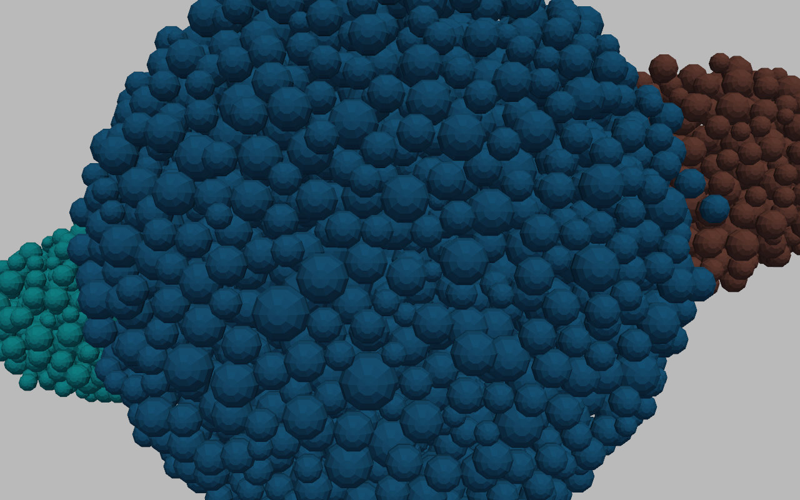

# Rubble-Pile Asteroid Collision Simulation Library

AI-assisted rewrite and expansion of my [asteroid2023](https://github.com/ianfr/asteroid2023) project. [Rubble-pile](https://en.wikipedia.org/wiki/Rubble_pile) asteroid collision simulator: rigid spheres, self-gravity, cohesion, CPU parallelism.

Note: The post-processing script has not been reviewed (yet).



The demo (**pictured above**) approximates Bennu as a 245 m radius sphere of mass 7.329e10 kg, rotating
about +z once every 4.296056 hours, using [OSIRIS-REx measurements](https://pmc.ncbi.nlm.nih.gov/articles/PMC6557581/).
Two hypothetical fragments of radii 100 m and 75 m have the same bulk density
(about 1190 kg/m³). They approach from opposite sides at 0.12 and 0.10 m/s,
starting with surface gaps of about 25 m and 19 m. Spring cohesion stays enabled;
the demo runs 2000 steps of at most 5 seconds each.

## Overview

Options via [simulation_config_t](Sources/asteroid2026/simulation_config_t.swift) and [builders](Sources/asteroid2026/asteroid_builder_t.swift)

- **Integration:** `.euler` ([Euler](https://en.wikipedia.org/wiki/Euler_method)), `.velocity_verlet` ([velocity Verlet](https://en.wikipedia.org/wiki/Verlet_integration#Velocity_Verlet)), `.runge_kutta4` ([RK4](https://en.wikipedia.org/wiki/Runge%E2%80%93Kutta_methods)).
- **Timestep:** `.fixed`, `.max_velocity`, `.mean_velocity`; configurable minimum/maximum.
- **Gravity:** direct pairwise or [Barnes–Hut](https://en.wikipedia.org/wiki/Barnes%E2%80%93Hut_simulation) octree; configurable gravitational constant, softening, opening angle, particle-count threshold.
- **Cohesion:** `.none` or `.spring` ([Hooke's law](https://en.wikipedia.org/wiki/Hooke%27s_law)); stiffness, damping, connection distance, bonding/breaking momentum thresholds. See [cohesion_config_t](Sources/asteroid2026/cohesion_t.swift).
- **Collisions:** spatial-grid detection, independent event batches; configurable [restitution](https://en.wikipedia.org/wiki/Coefficient_of_restitution), separation buffer, positional correction, iterations.
- **Asteroids:** spheres or ellipsoids; `.grid` or `.random_pack` ([random sequential packing](https://en.wikipedia.org/wiki/Random_sequential_adsorption)); uniform or normally distributed radii, constant density, target volume fraction, reproducible seeds; configurable mass, dimensions, position, velocity, color.
- **Output:** CSV frames for Python/ParaView; configurable output directory/cadence. Post-processing produces metrics, plots, `animation.gif`, and PNGs in `animation_frames/`.

[API](Sources/asteroid2026/simulation_t.swift): `simulation_t`, `add_spherical_asteroid`, `add_ellipsoid_asteroid`, `add_asteroid`, `advance`, `run`. [Demo setup](Sources/asteroid2026/asteroid2026.swift).

## Parallelism

Hands-off CPU parallelism via `DispatchQueue.concurrentPerform`:

- gravity: [brute force and octree queries](Sources/asteroid2026/gravity_t.swift).
- cohesion: [pair search and bond forces](Sources/asteroid2026/cohesion_t.swift).
- collision detection: [grid queries](Sources/asteroid2026/collision_t.swift).

GCD sizes its own worker pool, so there is no thread-count setting. Pin cores with `taskset` if needed.

## Prioritization of Collision Detection

Missed collisions (tunneling) are minimized in this library:

- [broad phase](Sources/asteroid2026/collision_t.swift) checks all 27 neighboring grid cells with cell size `2 * max_radius + separation_buffer`, so no in-range pair is skipped by binning.
- events sort deepest-first and resolve in [independent batches](Sources/asteroid2026/collision_t.swift), so a crowded pile resolves without one pair's impulse invalidating another's.
- [`handle_collisions`](Sources/asteroid2026/collision_t.swift) re-detects after each resolution pass, up to `collision_iterations` per step, and runs every [`advance`](Sources/asteroid2026/simulation_t.swift).
- [adaptive stepping](Sources/asteroid2026/collision_t.swift) shrinks the timestep when particles move fast relative to their radii, limiting per-step travel.

Knobs in [`simulation_config_t`](Sources/asteroid2026/simulation_config_t.swift): `separation_buffer` (catch pairs early), `collision_iterations` (repeat passes), `adaptive_mode` plus `max_timestep` / `min_timestep` (cap per-step motion).

## Commands

```sh
swift test
swift run -c release  # OUT/desktop/ast.csv.*
conda env create -f environment.yml
conda activate env_asteroid2026
python scripts/postprocess.py OUT/desktop --out plots --seconds-per-frame 1.5
```

Animation framing: `--view-percent 80` (default) combines each frame's central per-axis percentile bounds into one fixed view; use `100` for all positions.

Formatting: `swift-format -i -r Sources Tests`; `black scripts`. Install hook: `ln -s ../../hooks/pre-commit .git/hooks/pre-commit`.

